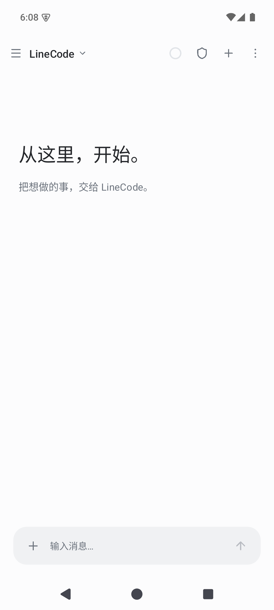
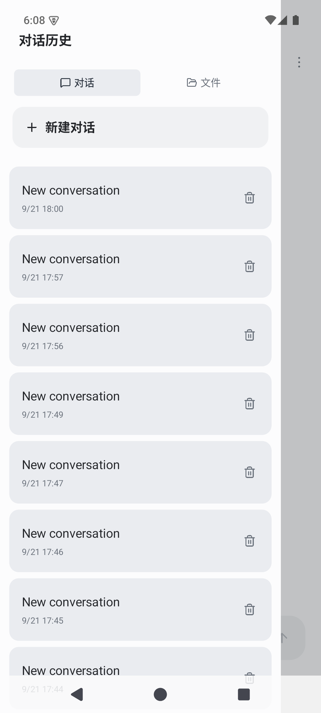
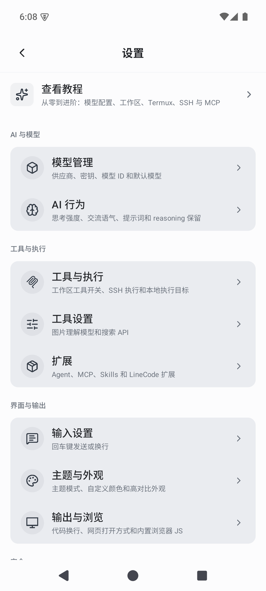

# LineCode Pro

[English](README.md) · 中文

[](https://github.com/LangLang03/LineCodePro/actions/workflows/ci.yml)
[](LICENSE)
[-3DDC84?style=flat-square&logo=android)](app/build.gradle.kts)
[](app/build.gradle.kts)

**LineCode Pro 是一个用纯手写 Java 11 构建的 Android AI 编程工作区。** 它把流式对话、项目感知工具、多 Agent 工作流、远程执行、扩展系统和本地数据管理放进一个可随身携带的界面。

它不只是聊天客户端。模型可以查看选中的工作区、提出或应用文件修改、执行经批准的命令、搜索网页、处理图片、把任务交给 Agent，并在多轮工具调用中持续工作；完整的执行时间线始终可见、可审查。

> LineCode Pro 仍在积极开发中。在重要环境中使用 AI 生成的代码和命令前，请先审查。

## 截图

<table>
  <tr>
    <td align="center"><br><sub>对话</sub></td>
    <td align="center"><br><sub>项目与历史</sub></td>
    <td align="center"><br><sub>模型、工具与外观</sub></td>
  </tr>
</table>

## 功能

- **模型无关的对话**：OpenAI 兼容 Chat Completions、OpenAI/Codex Responses、Anthropic Messages 和可选的本地 GGUF 模型共用一套流式接口。
- **完整工具循环**：读写、创建、编辑、搜索项目文件；执行 Shell；搜索网页；理解或生成图片；更新任务列表；在明确启用时通过无障碍服务控制手机。
- **Agent 与 Skills**：自定义 Agent、安装 `SKILL.md`、通过 SkillHub 发现社区 Skills、连接 HTTP MCP 服务。
- **多种工作区**：应用管理的项目、SSH 主机、Termux，或通过 AIDL 接入的 Android 终端提供者。
- **可审查的修改**：文件操作生成 diff 记录并支持回滚；思考、重试、审批、工具调用、输出和最终答案按顺序保留。
- **长会话支持**：上下文占用统计、软/硬压缩、长期记忆、项目记忆和聊天记录检索。
- **主题化手写界面**：明暗、跟随系统、纸张、高对比度、自定义配色、抽屉、Sheet、弹窗、Markdown 与代码展示，全部由 Java View 绘制，不使用 XML 布局。

## 架构

项目刻意拆分模块，避免行为重新坍缩回单个 Activity：

```text
app/                    Activity 壳、Manifest、资源、本地模型可选测试集
modules/
  core-*                模型 DTO、依赖注入、MVI、路由、设置
  engine-*              协议编解码、提示词、HTTP 客户端、工具循环、本地模型、SkillHub
  data                  SQLite schema v12、归档、迁移
  tool-*                工具契约、内置工具、MCP、媒体、Agent、手机控制
  ui-*                  主题 Token、i18n、组件、Markdown
  feature-*             聊天、设置、模型、扩展、工作区、终端
  platform-android      无障碍、保活、链接策略、调度器
  runtime               装配、页面工厂、SAF/归档操作
build-logic/            约定插件与机械守卫
modules/arch-test/      包归属、依赖、纯度和卫生测试
```

架构规则与禁止事项见 [AGENT.md](AGENT.md)。新增模块必须同时加入 `settings.gradle.kts` 和 `modules/arch-test/.../Modules.java`。

## 平台

| 平台 | 状态 | 说明 |
| --- | --- | --- |
| Android 8.0+（API 26+） | 主要支持 | 默认 **精简版** 不含 llama.cpp 原生库和本地模型入口；本地版为 arm64-v8a。 |
| Termux / Android 终端提供者 | 支持 | SSH 与 AIDL 终端提供者共用同一套工作区和文件树界面。 |

## 隐私与控制

会话、设置、记忆、扩展元数据和 diff 历史都保存在本地 SQLite。模型凭据和选中的项目内容只会发送到你明确配置或调用的服务。工具执行支持自动、确认、只读三种策略；除非用户明确关闭路径保护，文件工具被限制在当前工作区内。

导出和诊断路径会尽量脱敏，但分享归档或日志前仍应自行检查。第三方模型、MCP 端点、Skill、SSH 主机和 Web 服务都受其各自的隐私与安全策略约束。

## 获取

预编译产物和发布说明见 [GitHub Releases](https://github.com/LangLang03/LineCodePro/releases)。Android 发布包保留 `cn.lineai` 应用 ID，并延续既有的 LineCode 签名与版本序列。

## 从源码构建

需要：

- JDK 17（应用目标 Java 11）
- Android SDK platform 36
- Android SDK build-tools 36.0.0
- 仅在本地模型构建时需要 NDK `29.0.14206865` 和 CMake 3.22.1

所有命令都通过 Gradle Wrapper 执行。`settings.gradle.kts` 强制 `FAIL_ON_PROJECT_REPOS` 并配置了腾讯云 Maven 镜像；添加仓库时请保留。

### 精简版（默认）

默认构建即精简版：没有 llama.cpp `.so`、没有 `engine-local` Java、没有本地模型 UI。

```sh
./gradlew clean :app:assembleDebug
# → app/build/outputs/apk/debug/app-debug.apk

./gradlew verifyAll :arch-test:test
./gradlew test :app:testDebugUnitTest
./gradlew :app:lintDebug
```

### 本地模型（llama.cpp）

本地 GGUF 模型通过内置 llama.cpp JNI 在本进程运行。该后端是构建参数，默认构建完全不包含它。本地版是超集：包含精简版全部功能，并额外提供本地模型页面、协议入口、GGUF 导入和原生运行时。

| 构建参数 | 默认值 | 作用 |
| --- | --- | --- |
| `linecodeEnableLocalModel` | `false` | 编译 `engine-local` 和本地 UI，显示“本地模型”入口与协议页；关闭时全部移除。 |
| `linecodeLocalModelBundle` | 跟随 `linecodeEnableLocalModel` | 把 `libllama.so`、`libggml*.so`、`libc++_shared.so` 打进 APK。 |
| `linecodeLocalModelGpu` | `true` | 在本地模型表单中提供 GPU 加速选项。 |
| `linecodeLlamaCppSourceDir` | `third_party/llama-cpp` | llama.cpp 头文件目录。 |
| `linecodeLlamaPrebuiltDir` | `third_party/llama-cpp/prebuilt/arm64-v8a` | arm64 预编译 llama.cpp 库目录。 |

```sh
# 完整本地模型版，包含原生库。
./gradlew clean :app:assembleDebug -PlinecodeEnableLocalModel=true

# Release。
./gradlew clean :app:assembleRelease -PlinecodeEnableLocalModel=true
```

本地版链接仓库内置的 `third_party/llama-cpp` 头文件与 arm64 预编译运行库（见该目录 README）；也可以通过上述两个目录属性指向独立的 llama.cpp 检出。只打开后端但不打包库的构建仍会链接它，但 APK 中不含共享库，仅用于开发。

切换精简版/本地版必须先执行 `clean`，因为两个变体写入同一个 APK 路径；否则旧的增量打包可能残留 zipflinger 虚拟条目填充。

导入的 GGUF 文件会复制到应用自己的 `models` 目录，因为系统选择器返回的是 URI 能力而不是运行库可直接打开的路径。NPU 加速刻意不提供；当前链接的运行时只暴露 CPU 与 GPU 后端。

### Release 签名

Release APK 需要仓库根目录的 `signing.properties`：

```properties
storeFile=/abs/path/to/your.keystore
storePassword=…
keyAlias=…
keyPassword=…
```

不要提交签名材料。Release 构建会在 R8 之前校验这些属性，导出 `LineCode Pro <versionName>-slim.APK`（本地模型版为 `-local.APK`），并清理符号归档。

## 社区

- QQ 讨论群：**1023548832**
- [GitHub Discussions](https://github.com/LangLang03/LineCodePro/discussions)：设计讨论与一般问题
- [GitHub Issues](https://github.com/LangLang03/LineCodePro/issues)：可复现缺陷和范围明确的功能请求

QQ 群仅用于社区讨论。商业许可或 CLA/法律问题请联系 **jiyu03@qq.com**。

## 贡献

欢迎贡献。提交 PR 前请阅读 [CONTRIBUTING.md](CONTRIBUTING.md)。每个 PR 必须包含贡献者的 GitHub 用户名作为接受 [CLA.md](CLA.md) 的电子签名；必需的 `CLA / verify` 检查会拒绝未签署的 PR。

## 许可证

LineCode Pro 采用双重许可：

- 开源使用适用 **GNU AGPL v3 或更高版本**；见 [LICENSING.md](LICENSING.md) 与 [LICENSE](LICENSE)。
- 无法满足 AGPL 义务的组织可以申请单独的商业许可；见 [COMMERCIAL-LICENSE.md](COMMERCIAL-LICENSE.md)。

除非有书面商业协议另行约定，获取或使用源码本身不授予商业许可例外。

## 致谢

LineCode Pro 受益于 [llama.cpp](https://github.com/ggml-org/llama.cpp)（MIT）、[commonmark-java](https://github.com/commonmark/commonmark-java)（BSD-2-Clause）、[JSch](https://github.com/mwiede/jsch)（BSD 风格）以及 Android Jetpack 等开源项目。所有第三方组件仍受其各自许可证约束；随 APK 分发的声明继续适用。
